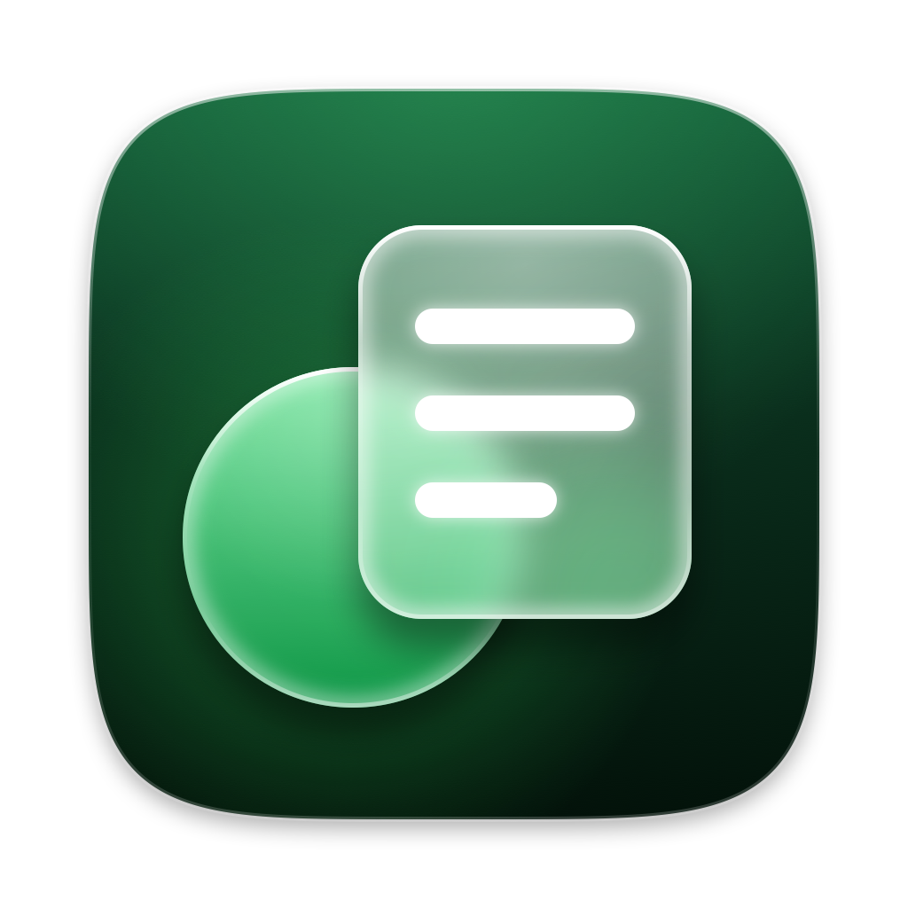

  

<h1 align="center">Suki</h1>

<h3 align="center">Talk. Suki types. In any app on your Mac.</h3>

  <a href="https://github.com/ansuman-shukla/Suki/releases/latest"><b>⬇ Download for Mac</b></a> 
  Free · Open source · Under 10MB

https://github.com/user-attachments/assets/b22efd06-0946-4ac7-b02e-1bec8603acff

## Why Suki

- **Tiny.** 20x smaller than Wispr Flow.
- **Free.** No subscription, no word limits.
- **Private.** No account, no Suki server.
- **Any AI.** OpenAI, Groq, Gemini, Claude, or local models.
- **Knows your words.** Custom dictionary and snippets.

## Get Started

1. Download Suki and drag it to Applications.
2. First launch: **System Settings → Privacy & Security → Open Anyway**.
3. Paste a free [Groq key](https://console.groq.com/keys).
4. Hold `Fn` and talk.

## Suki vs Wispr Flow

|                    | Suki  | Wispr Flow |
| ------------------ | ----- | ---------- |
| Unlimited use      | Free  | $15/month  |
| Size               | 25MB  | 500MB      |
| Pick your AI model | ✓     | ✗          |
| Local models       | ✓     | ✗          |
| Open source        | ✓     | ✗          |

---

[Advanced setup, privacy & FAQ](docs/advanced.md) · [Contributing](CONTRIBUTING.md) · MIT License
