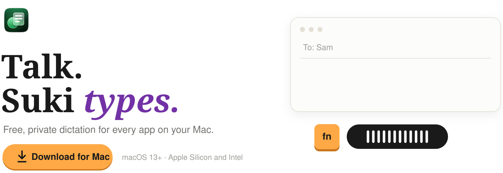
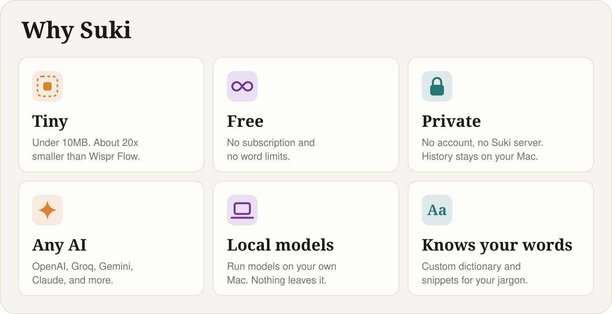
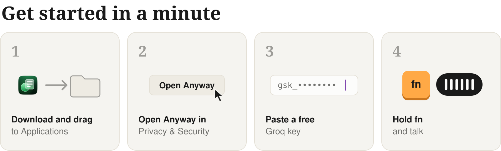
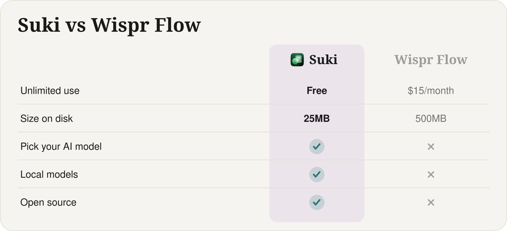

<picture>
  <source media="(prefers-color-scheme: dark)" srcset="docs/assets/readme/hero-dark.svg">
  
</picture>

  
   
  Free · Open source · macOS 13+ · Apple Silicon and Intel

<picture>
  <source media="(prefers-color-scheme: dark)" srcset="docs/assets/readme/demo-dark.svg">
  
</picture>

https://github.com/user-attachments/assets/b22efd06-0946-4ac7-b02e-1bec8603acff

 

<picture>
  <source media="(prefers-color-scheme: dark)" srcset="docs/assets/readme/features-dark.svg">
  
</picture>

  

<picture>
  <source media="(prefers-color-scheme: dark)" srcset="docs/assets/readme/steps-dark.svg">
  
</picture>

<a href="https://console.groq.com/keys">Get a free Groq key →</a>

 

<picture>
  <source media="(prefers-color-scheme: dark)" srcset="docs/assets/readme/compare-dark.svg">
  
</picture>

  

  <a href="docs/advanced.md">Advanced setup, privacy &amp; FAQ</a> · <a href="CONTRIBUTING.md">Contributing</a> · MIT License

